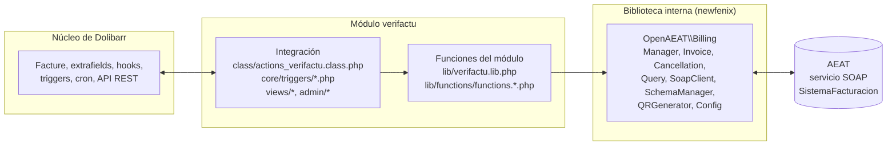
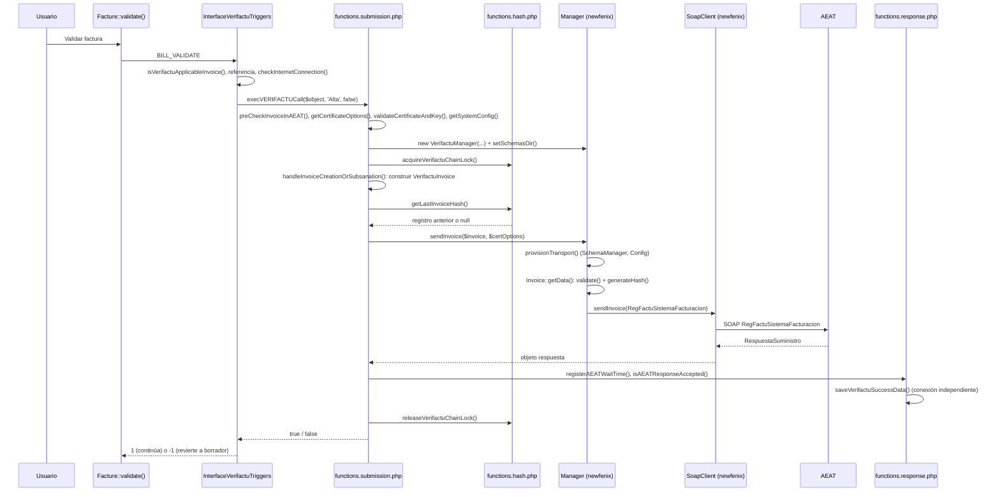

# Arquitectura del módulo

Esta página describe cómo está organizado internamente el módulo VeriFactu para Dolibarr (versión 2.2.4): qué hay en cada carpeta, cómo se carga el código en cada petición, por qué puntos entra Dolibarr en el módulo (hooks, triggers, tarea programada, sustituciones, modelo PDF), cómo se reparten las responsabilidades entre el núcleo de Dolibarr, las funciones del módulo, la biblioteca interna `newfenix` y el servicio SOAP de la AEAT, dónde se guardan los datos y qué convenciones de nombres sigue el código. Es la página de referencia para quien quiera leer o modificar el módulo; las páginas de uso enlazadas al final explican cada comportamiento con más detalle.

## Capas

El módulo se apoya en cuatro capas con dependencias en un solo sentido:



- **Núcleo de Dolibarr.** Aporta la factura (`Facture`), los campos adicionales donde se persiste el estado VeriFactu, el gestor de hooks, los triggers de negocio, el planificador de tareas y el framework de la API REST.
- **Integración.** La clase de hooks `ActionsVerifactu`, los dos triggers, las páginas de administración y las vistas. Traducen los eventos de Dolibarr (validar una factura, generar un PDF, imprimir un ticket) en llamadas a las funciones del módulo.
- **Funciones del módulo.** Funciones PHP globales, agrupadas por tema en `lib/functions/`, que contienen la lógica de negocio: qué se envía, cuándo, con qué certificado, cómo se encadena y cómo se guarda la respuesta. Conocen Dolibarr (`$conf`, `$db`, `Facture`, `dol_syslog()`).
- **Biblioteca interna.** `lib/newfenix/` (OpenAEAT Billing) construye los registros de facturación, calcula la huella, valida los límites del esquema y habla SOAP con la AEAT. No usa ninguna función ni objeto de Dolibarr; se puede ejecutar de forma autónoma. Ver [[Biblioteca newfenix|Biblioteca-newfenix]].

## Árbol de directorios

```text
verifactu/
├── admin/
│   ├── setup.php                     Pantalla de configuración (FormSetup), estado del entorno,
│   │                                 estado de los esquemas WSDL/XSD, cambio de entorno
│   ├── managecertificates.php        Subida y conversión de certificados PFX/P12 a PEM
│   ├── uploadcertificates.php        Gestor de ficheros de certificados (con conversión automática)
│   ├── about.php                     Página «Acerca de»
│   └── copying.php                   Texto de la licencia GPL
├── class/
│   ├── actions_verifactu.class.php   Clase de hooks ActionsVerifactu (validación, botones, QR, PDF, TPV, ODT)
│   ├── api_verifactu.class.php       API REST (clase VerifactuApi): integridad y cambio de entorno
│   └── verifactu.utils.php           VerifactuUtils: reintento de envíos pendientes (tarea programada)
├── conf/
│   └── declaracion_responsable.conf.php   Declaración responsable e identidad del sistema informático
├── core/
│   ├── modules/
│   │   ├── modVerifactu.class.php    Descriptor del módulo: constantes, permisos, menús, extrafields, cron
│   │   └── facture/doc/pdf_verifactu.modules.php   Modelo PDF «verifactu» con QR
│   ├── substitutions/functions_verifactu.lib.php   Sustitución FACTUREVERIFACTUTAB (título de la pestaña)
│   ├── tpl/extrafields_list_array_fields.tpl.php   Columnas verifactu_* visibles por defecto en listados
│   └── triggers/
│       ├── interface_900_modVerifactu_BillRestrictions.class.php   Bloqueos sobre facturas ya numeradas
│       └── interface_999_modVerifactu_VerifactuTriggers.class.php  BILL_CREATE, BILL_VALIDATE, COMPANY_MODIFY
├── css/verifactu.css.php             Hoja de estilos cargada en todas las páginas
├── js/verifactu.js.php               JavaScript cargado en todas las páginas
├── docs/responsible_declaration.md   Guía (en inglés) del fichero de declaración responsable
├── img/                              Iconos del módulo (object_verifactu.png, img/menus/)
├── langs/{es_ES,en_US,ca_ES,eu_ES,gl_ES}/verifactu.lang   Traducciones
├── lib/
│   ├── verifactu.lib.php             Punto de entrada: carga autoload, vendor y functions.*.php en orden
│   ├── verifactu-types.array.php     Tablas de códigos AEAT (L1 impuestos, L2 tipos, L8 regímenes, L9, L10…)
│   ├── dumper.php                    dumper(): volcado legible de arrays/objetos (pestaña VeriFactu)
│   ├── functions/
│   │   ├── functions.compatibility.php   Diferencias entre versiones de Dolibarr y exclusión de proformas
│   │   ├── functions.utilities.php       prettyXML(), comprobación de conexión a Internet
│   │   ├── functions.configuration.php   Entorno, identidad del sistema, hash de integridad, NIF por entidad
│   │   ├── functions.admin.php           Pestañas de la administración
│   │   ├── functions.certificates.php    Certificados: PEM, OpenSSL, validez X.509, opciones SOAP
│   │   ├── functions.hash.php            Bloqueo de la cadena y lectura del último registro
│   │   ├── functions.qr.php              URL y QR de verificación
│   │   ├── functions.response.php        Tiempo de espera AEAT, aceptación, guardado con conexión propia
│   │   ├── functions.submission.php      execVERIFACTUCall(): alta y subsanación
│   │   ├── functions.cancellation.php    Anulaciones
│   │   └── functions.query.php           Consultas, precomprobación y duplicados
│   └── newfenix/                     Biblioteca OpenAEAT Billing (independiente de Dolibarr)
│       ├── autoload.php              Carga de clases y alias Sietekas\Verifactu\*
│       ├── composer.json             Paquete openaeat/billing
│       ├── phpunit.xml               Configuración PHPUnit de la biblioteca
│       ├── src/                      BillingException, Config, SoapClient, Invoice, Cancellation,
│       │                             Query, SchemaManager, Manager, QRGenerator
│       └── vendor/                   chillerlan/php-qrcode 5.0.4 y chillerlan/php-settings-container 2.1.6
├── sql/dolibarr_allversions.sql      Vacío (solo un comentario): el módulo no crea tablas propias
├── tests/                            Suite de regresión (scripts PHP autónomos)
├── views/
│   ├── tabVERIFACTU.facture.php      Pestaña VeriFactu de la factura
│   ├── list.facture.php              Lista «Facturas emitidas» con envío masivo
│   ├── query.facture.php             Consulta a la AEAT
│   ├── pos.facture.php               Ticket del TPV con QR
│   ├── declaration.php               Declaración responsable
│   ├── declaration_json.php          Exportación JSON de la declaración
│   ├── documentation.php             Listado de la carpeta documentation/ (no se distribuye)
│   └── faq.php                       Ayuda y preguntas frecuentes
├── verifactuindex.php                Panel principal (estadísticas)
├── integrity.php                     Comprobación de integridad en JSON, sin sesión
├── .github/workflows/                release.yml (publicación de versiones) y limpiar-ramas.yml
├── COPYING                           Licencia GPL-3.0
└── README.md                         Documentación y registro de cambios
```

## Cómo arranca el módulo en cada petición

El módulo no tiene un «arranque» propio: se carga a través de los mecanismos estándar de Dolibarr, en este orden.

1. **Descriptor.** `core/modules/modVerifactu.class.php` declara en `$this->module_parts` los contextos de hooks que gestiona (`main`, `invoicecard`, `invoicelist`, `invoicelistverifactu`, `pdfgeneration`, `takeposfrontend`, `odtgeneration`), además de `triggers => 1`, `substitutions => 1`, `models => 1` y las rutas de `css` y `js`. Dolibarr guarda esa información en `$conf->modules_parts` al activar el módulo.
2. **Hook `main` en todas las páginas.** `main.inc.php` del núcleo llama a `$hookmanager->initHooks(array('main'))` en cada petición autenticada. Como el módulo declara el contexto `main`, el gestor de hooks incluye `class/actions_verifactu.class.php` e instancia `ActionsVerifactu` en todas las páginas de Dolibarr.
3. **Carga de la biblioteca.** La primera línea útil de `actions_verifactu.class.php` es `dol_include_once('/verifactu/lib/verifactu.lib.php')`. Ese fichero es el punto de entrada único del módulo y carga, en este orden:
   - `lib/newfenix/autoload.php` (clases `OpenAEAT\Billing\*` y alias `Sietekas\Verifactu\*`);
   - `lib/newfenix/vendor/autoload.php` (chillerlan/php-qrcode);
   - `core/lib/files.lib.php` y `core/lib/admin.lib.php` del núcleo;
   - los módulos de funciones `lib/functions/functions.*.php`, ordenados por dependencias (ver tabla siguiente).
   Todas las inclusiones usan `dol_include_once()` o `require_once`, de modo que cargar el fichero varias veces desde distintos puntos de entrada no tiene efecto.
4. **Hook `updateSession`.** Inmediatamente después, `main.inc.php` ejecuta `executeHooks('updateSession')`. `ActionsVerifactu::updateSession()` aprovecha esa llamada en cada página para: redirigir el ticket del TPV «2byte» (`pos/frontend/tpl/facture.tpl.php`) a `views/pos.facture.php`; forzar `SOCIETE_IDPROF1_INVOICE_MANDATORY` a `false` en memoria (la comprobación del NIF la hace el trigger); e impedir el borrado de cualquier campo adicional cuyo nombre empiece por `verifactu_` desde las páginas de administración de extrafields (mensaje `VERIFACTU_CANNOT_DELETE_EXTRA_FIELD`).
5. **CSS y JS.** `css/verifactu.css.php` y `js/verifactu.js.php` se incluyen en la cabecera de todas las páginas por estar declarados en `module_parts`.

Los demás puntos de entrada cargan la biblioteca por su cuenta con la misma línea `dol_include_once('/verifactu/lib/verifactu.lib.php')`: el trigger principal, `class/api_verifactu.class.php`, `class/verifactu.utils.php`, `integrity.php`, las vistas `tabVERIFACTU.facture.php`, `query.facture.php` y `pos.facture.php`, y las páginas de `admin/`. El descriptor la carga también al final de `init()`.

> **Nota:** el gestor de hooks de Dolibarr ejecuta cada método hookeado sobre todas las clases de acciones cargadas en la petición, sea cual sea el contexto con el que se inicializaron. Como `ActionsVerifactu` se carga siempre por el contexto `main`, sus métodos responden en cualquier página; por eso varios de ellos comprueban `$parameters['context']` antes de actuar (`doActions()`, `dolGetButtonAction()`), y otros comprueban el tipo del objeto (`getNomUrl()`, `moreHtmlStatus()`, `formDolBanner()`, `beforePDFCreation()`).

### Orden de carga de los módulos de funciones

`lib/verifactu.lib.php` documenta en su cabecera qué hace cada fichero y los carga en este orden, que respeta sus dependencias:

| Orden | Fichero | Responsabilidad | Funciones principales |
|---|---|---|---|
| 1 | `functions.compatibility.php` | Diferencias entre versiones de Dolibarr | `getInvoiceTotalHT()`, `getInvoiceTotalTVA()`, `getVerifactuImporteTotal()`, `isVerifactuApplicableInvoice()` |
| 1 | `functions.utilities.php` | Utilidades sin dependencias | `prettyXML()`, `checkInternetConnection()`, `checkHttpConnection()`, `checkDnsResolution()`, `checkPingConnection()`, `isWindowsWithoutPing()` |
| 2 | `functions.configuration.php` | Entorno y configuración del sistema | `getEnvironment()`, `getVerifactuDomain()`, `calculateVerifactuIntegrityChecksums()`, `getDeclaredSystemIdentity()`, `getSystemConfig()`, `getVerifactuParams()`, `hasVerifactuFiscalRecords()`, `getVerifactuEntityWithSameTaxId()`, `isVerifactuInvoiceNumberingShared()` |
| 2 | `functions.admin.php` | Pestañas de la administración | `verifactuAdminPrepareHead()` |
| 3 | `functions.certificates.php` | Certificados (depende de la configuración) | `getCertificateOptions()`, `prepareCertificateForVerifactu()`, `validateCertificateAndKey()`, `prepareLocalCertificate()`, `runOpensslPkcs12()`, `extractPkcs12WithPhp()`, `deleteExistingPemFiles()` |
| 4 | `functions.hash.php` | Cadena: bloqueo y registro anterior | `acquireVerifactuChainLock()`, `releaseVerifactuChainLock()`, `getLastInvoiceHash()` |
| 4 | `functions.qr.php` | QR de verificación | `getQrImage()`, `getQrBase64()`, `getQRUrl()`, `isInvoiceSentToVerifactu()` |
| 4 | `functions.response.php` | Respuestas de la AEAT | `registerAEATWaitTime()`, `getAEATWaitTimeRemaining()`, `isAEATResponseAccepted()`, `saveVerifactuErrorData()`, `saveVerifactuSuccessData()`, `buildVerifactuOutputSummary()` |
| 5 | `functions.submission.php` | Alta y subsanación | `execVERIFACTUCall()`, `handleInvoiceCreationOrSubsanation()`, `processInvoiceSendResponse()` |
| 5 | `functions.cancellation.php` | Anulación | `handleInvoiceCancellation()`, `createCancellationByType()`, `processCancellationResponse()` |
| 5 | `functions.query.php` | Consultas | `execVERIFACTUQuery()`, `buildQueryFromFilter()`, `preCheckInvoiceInAEAT()`, `manejarFacturaDuplicada()` |

Tras las inclusiones, `verifactu.lib.php` declara las sentencias `use Sietekas\Verifactu\VerifactuInvoice`, `VerifactuInvoiceCancel`, `VerifactuManager`, `VerifactuInvoiceQuery` y `QRGenerator`: son los alias históricos de las clases de la biblioteca, que es como las nombra el código del módulo (ver [[Biblioteca newfenix|Biblioteca-newfenix]]).

## Puntos de entrada de Dolibarr en el módulo

### Hooks

Contextos declarados en `module_parts['hooks']` y métodos de `ActionsVerifactu` (`class/actions_verifactu.class.php`) que actúan en cada uno:

| Contexto | Dónde lo inicializa Dolibarr | Métodos que actúan | Qué hacen |
|---|---|---|---|
| `main` | Todas las páginas (`main.inc.php`) | `updateSession()`, `printCommonFooter()`, `getNomUrl()` | Redirección del TPV 2byte, protección de extrafields; en `/admin/facture.php` desactiva el selector `forcedate`; añade el estado VeriFactu junto al enlace de la factura |
| `invoicecard` | Ficha de la factura | `doActions()`, `dolGetButtonAction()`, `formDolBanner()`, `moreHtmlStatus()`, `addMoreActionsButtons()` | Fuerza la fecha de validación a `max(hoy, última validada)` y reescribe el texto de confirmación; sustituye los botones Modificar/Eliminar por versiones deshabilitadas en facturas numeradas y deshabilita Validar si faltan NIF, NIF-IVA o dirección; pinta el QR tributario en la cabecera. `addMoreActionsButtons()` está vacío |
| `invoicelist`, `invoicelistverifactu` | Lista de facturas del núcleo y `views/list.facture.php` | `doActions()` | Intercepta la acción masiva `validate` y valida cada factura en su propia transacción, con control cronológico de fechas |
| `pdfgeneration` | Generación de PDF | `beforePDFCreation()`, `afterPDFCreation()`, `pdf_build_address()` | Cambia el título del PDF en simplificadas; añade el QR con TCPDI tras generar el PDF; vacía el bloque de dirección del destinatario en simplificadas |
| `takeposfrontend` | TakePOS | `TakeposReceipt()` | Genera el ticket completo con el QR |
| `odtgeneration` | Plantillas ODT | `ODTSubstitution()` | Crea las imágenes `verifactuqrcode30_logo`, `verifactuqrcode35_logo` y `verifactuqrcode40_logo` |

Además, `doActions()` comprueba los contextos `thirdpartycomm` y `thirdpartycard` (no declarados en el descriptor, pero alcanzables porque la clase ya está cargada por `main`) para sustituir las etiquetas «NIF-IVA» y «CIF» por las traducciones `VATIntraVerifactu` y `ProfId1ESVerifactu`. `loadDataForCustomReports()` añade una pestaña a los informes personalizados. `doMassActions()` y `addMoreMassActions()` conservan el código de ejemplo de ModuleBuilder (contextos `somecontext1`/`somecontext2`) y no tienen efecto.

### Triggers

| Fichero | Clase | Prioridad | Eventos | Comportamiento |
|---|---|---|---|---|
| `core/triggers/interface_900_modVerifactu_BillRestrictions.class.php` | `InterfaceBillRestrictions` | 900 (antes que el principal) | `BILL_DELETE`, `LINEBILL_INSERT`, `LINEBILL_UPDATE`, `LINEBILL_DELETE`, `BILL_UNVALIDATE` | Si la referencia de la factura no contiene `PROV`, devuelve `-1` con el mensaje `VERIFACTU_INVOICE_CAN_NOT_BE_MODIFIED`, lo que aborta la operación. Ver [[Restricciones sobre facturas enviadas|Restricciones-sobre-facturas-enviadas]] |
| `core/triggers/interface_999_modVerifactu_VerifactuTriggers.class.php` | `InterfaceVerifactuTriggers` | 999 (después de los demás) | `BILL_CREATE` | `billCreate()`: inicializa los campos adicionales (estado «No enviada», impuesto, régimen, calificación, exención) y fija el tipo VeriFactu según el tipo de factura de Dolibarr, el origen TakePOS y la configuración del tercero |
| | | | `BILL_VALIDATE` | `billValidate()`: excluye proformas, valida la referencia definitiva (sin espacios, alfanumérica, máximo 60), comprueba la conexión, reintenta pendientes, aplica los requisitos del tercero y llama a `execVERIFACTUCall($object, 'Alta', false)`; si el envío falla revierte la factura a borrador con una conexión independiente. Si el envío directo está desactivado deja la factura como pendiente (`PENDING_SUBMISSION`) |
| | | | `COMPANY_MODIFY` | `companyModify()`: impide cambiar o vaciar el NIF (o el NIF-IVA) de un tercero con facturas ya remitidas |

Ambos triggers salen sin hacer nada si `$conf->verifactu->enabled` está vacío. El método a ejecutar se resuelve a partir del nombre del evento (`BILL_VALIDATE` → `billValidate()`), como en los triggers generados por ModuleBuilder.

### Tarea programada

El descriptor registra una tarea en el módulo de trabajos programados: etiqueta `sendInvoicesWithErrorsCronName`, método `VerifactuUtils::sendInvoicesWithErrors()` de `class/verifactu.utils.php`, cada 2 horas (`frequency` 2 × `unitfrequency` 3600), activa desde la instalación y condicionada a `$conf->verifactu->enabled`. Recoge las facturas validadas de la entidad activa sin huella y con error `NO_INTERNET_CONNECTION`, `SERVICE_UNAVAILABLE` o `PENDING_SUBMISSION`, y las envía por orden de fecha. El mismo método se ejecuta también al principio de cada validación cuando hay conexión. Ver [[Reintentos y envíos pendientes|Reintentos-y-envios-pendientes]].

### Otros puntos de integración

- **Pestaña de la factura.** `$this->tabs` añade `factureVERIFACTU_TAB` a la ficha de factura, apuntando a `views/tabVERIFACTU.facture.php`, visible con el permiso `verifactu->manage` o para administradores. Su título se resuelve con la sustitución `FACTUREVERIFACTUTAB` de `core/substitutions/functions_verifactu.lib.php`.
- **Menús.** Menú superior «Verifactu» (`verifactuindex.php`) y entradas laterales: declaración responsable, facturas emitidas, consulta AEAT, documentación, ayuda y configuración. Ver [[Permisos y menús|Permisos-y-menus]].
- **Permiso.** Un único permiso, `manage` (`PERMISSIONS_MANAGE_VERIFACTU`), con identificador `35010001`.
- **Modelo PDF.** `core/modules/facture/doc/pdf_verifactu.modules.php`, disponible porque `module_parts['models'] = 1`. Ver [[Plantilla PDF verifactu|Plantilla-PDF-verifactu]].
- **Listados.** `core/tpl/extrafields_list_array_fields.tpl.php` marca `verifactu_estado` y `verifactu_csv_factura` como columnas visibles por defecto y oculta el resto de campos `verifactu_*`.
- **Dependencias.** `$this->depends` exige `modFacture`, `modBlockedLog` y `modApi`; `init()` rechaza la activación si falta la extensión `soap`.

## Flujo de datos de una validación



Puntos que conviene retener:

- El envío ocurre **dentro** de la transacción de `Facture::validate()`. Por eso los resultados se guardan con una conexión de base de datos independiente (`saveVerifactuSuccessData()`, `saveVerifactuErrorData()`), y por eso el trigger revierte manualmente la factura a borrador con referencia `(PROVn)` cuando el envío falla.
- La sección crítica (leer el registro anterior, enviar, guardar la huella nueva) está serializada por `acquireVerifactuChainLock()` con `GET_LOCK()` en MySQL o un *advisory lock* en PostgreSQL, por entidad y entorno (desde la 2.1.0).
- La biblioteca no toca la base de datos ni conoce la factura de Dolibarr: recibe un `VerifactuInvoice` ya construido y devuelve el objeto de respuesta de PHP `SoapClient`.

El detalle paso a paso está en [[Flujo de validación y envío|Flujo-de-validacion-y-envio]]; el encadenamiento, en [[Encadenamiento y huella|Encadenamiento-y-huella]].

## Dónde se persisten los datos

El módulo no crea tablas propias (`sql/dolibarr_allversions.sql` solo contiene un comentario). Todo se guarda en estructuras del núcleo y en la carpeta de documentos.

### Campos adicionales de la factura (`llx_facture_extrafields`)

Creados por `modVerifactu::init()` con `ExtraFields::addExtraField()`; todos con permiso `verifactu->manage` o administrador y condición `$conf->verifactu->enabled`.

| Campo | Tipo | Contenido |
|---|---|---|
| `verifactu_estado` | varchar 255 | Estado como insignia HTML («No Enviada», «Enviada», «Pendiente», «Error», «Parcial»…) |
| `verifactu_error` | text 500 | Último error o marcador de reintento (`NO_INTERNET_CONNECTION`, `SERVICE_UNAVAILABLE`, `PENDING_SUBMISSION`) |
| `verifactu_csv_factura` | text 255 | CSV devuelto por la AEAT |
| `verifactu_id_factura` | text 255 | JSON con `IDEmisorFactura`, `NumSerieFactura`, `FechaExpedicionFactura` de la respuesta |
| `verifactu_fecha_factura` | date | Fecha de expedición confirmada por la AEAT |
| `verifactu_ultima_salida` | text 255 | Resumen legible de la última respuesta |
| `verifactu_ultimafecha_modificacion` | datetime | Última actualización del estado |
| `verifactu_huella` | text 255 | Huella SHA-256 del registro (eslabón de la cadena) |
| `verifactu_fecha_hora_generacion` | varchar 50 | `FechaHoraHusoGenRegistro` del registro |
| `verifactu_entorno` | select | `test` o `production`: entorno al que se remitió |
| `verifactu_modo` | varchar 255 | Modo de operación (insignia) |
| `verifactu_payload` | text 50000 | JSON del registro enviado (`Manager::getLastSendInvoiceData()`); no se lista |
| `verifactu_factura_tipo` | select | Tipo AEAT (F1, F2, R1…), por defecto `F1` |
| `verifactu_impuesto` | select | L1, por defecto `01` |
| `verifactu_clave_regimen` | select | L8, por defecto `01` |
| `verifactu_calificacion_operacion` | select | L9 (S1, S2, N1, N2) |
| `verifactu_operacion_exenta` | select | L10 (E1–E6) |
| `verifactu_incidencia` | select | `S`/`N`, por defecto `N`; pasa a `S` en los envíos diferidos |
| `verifactu_inicio_separador1`, `verifactu_inicio_separador2` | separate | Separadores visuales |

### Campos adicionales del tercero (`llx_societe_extrafields`)

`verifactu_tipo_identificacion` (por defecto `02`), `verifactu_impuesto`, `verifactu_clave_regimen`, `verifactu_calificacion_operacion`, `verifactu_operacion_exenta` (valores por defecto para las facturas del tercero, con prioridad sobre los globales) y `verifactu_factura_simplificada` (booleano: el cliente factura siempre en simplificada). Ver [[Campos adicionales|Campos-adicionales]].

### Constantes (`llx_const`)

La configuración vive en constantes `VERIFACTU_*` por entidad: las 21 que el descriptor crea al activar (`VERIFACTU_DIRECT_CALL_ON_VALIDATE`, `VERIFACTU_QR_*`, `VERIFACTU_MODE`, `VERIFACTU_DEFAULT_*`, `VERIFACTU_CERT_TYPE`, `VERIFACTU_COMPANY_TYPE`…), las que rellena la pantalla de ajustes (`VERIFACTU_HOLDER_NIF`, `VERIFACTU_HOLDER_COMPANY_NAME`, `VERIFACTU_CERTIFICATE`, `VERIFACTU_CERTIFICATE_KEY`, `VERIFACTU_FORCE_PRODUCTION_ENVIRONMENT`, `VERIFACTU_CHAIN_LOCK_TIMEOUT`) y las de estado que escribe el propio código (`VERIFACTU_NEXT_SEND_AT`, con el instante hasta el que la AEAT pide esperar). El descriptor también fija constantes del núcleo (`INVOICE_DISALLOW_REOPEN`, `INVOICE_CAN_NEVER_BE_REMOVED`, `FAC_FORCE_DATE_VALIDATION`, `INVOICE_CHECK_POSTERIOR_DATE`, `BLOCKEDLOG_DISABLE_NOT_ALLOWED_FOR_COUNTRY`, `SOCIETE_IDPROF1_INVOICE_MANDATORY`). Ver [[Configuración|Configuracion]].

### Carpeta de documentos

El descriptor pide crear `/verifactu/temp` y `/verifactu/certificates` bajo la carpeta de documentos. El código siempre resuelve la ruta con `$conf->verifactu->multidir_output[$conf->entity]`, que Dolibarr define como `DOL_DATA_ROOT/verifactu` para la entidad 1 y `DOL_DATA_ROOT/<entidad>/verifactu` para las demás entidades con Multiempresa.

```text
documents/verifactu/              (o documents/<entidad>/verifactu/)
├── certificates/                 PFX/P12 subidos y ficheros PEM generados (permisos 0600)
├── schemas/                      WSDL y XSD de la AEAT y del W3C + schemas.meta.json
└── temp/
```

La carpeta `schemas/` no la crea el descriptor: la crea `SchemaManager::downloadSchemas()` la primera vez que hace falta. Ver [[Esquemas WSDL y XSD|Esquemas-WSDL-y-XSD]] y [[Certificados digitales|Certificados-digitales]].

### Otros almacenamientos

- Imágenes temporales del QR para ODT en `sys_get_temp_dir()` (`qr_verifactu_*.png`).
- Bloqueo de la cadena en la sesión de base de datos (no se persiste; desaparece si el proceso muere).
- Trazas en el registro de Dolibarr mediante `dol_syslog()`, con el prefijo `VERIFACTU`. Ver [[Registro y depuración|Registro-y-depuracion]].

## Convenciones de nombres

- **Ficheros de funciones:** `lib/functions/functions.<ámbito>.php`, un ámbito por fichero, cargados en orden de dependencia desde `lib/verifactu.lib.php`, cuya cabecera actúa como índice.
- **Nombres en inglés con alias en castellano.** Al traducir el código se conservaron los nombres antiguos para no romper llamadas: `execVERIFACTUCall()` y `executeVerifactuCall()`, `isInvoiceSentToVerifactu()` y `isFactureSendToVerifactu()`, `getVerifactuParams()` devuelve las claves `taxType`/`tipoImpuesto`, `regimeKey`/`claveRegimen`…, y `getLastInvoiceHash()` devuelve `numero`/`number` y `fecha`/`date`.
- **Clases de la biblioteca.** El módulo las nombra por los alias `Sietekas\Verifactu\VerifactuInvoice`, `VerifactuInvoiceCancel`, `VerifactuInvoiceQuery`, `VerifactuManager` y `QRGenerator`; las clases reales están en `OpenAEAT\Billing`. `admin/setup.php` y los tests usan los nombres reales.
- **Prefijos.** Constantes `VERIFACTU_*`, campos adicionales `verifactu_*`, claves de traducción `VERIFACTU_*` y `verifactu_*`, mensajes de registro `VERIFACTU ...`.
- **Estados como insignias.** `verifactu_estado` guarda el HTML de la insignia; el código distingue el estado por la clase (`badge-status4` enviada, `badge-status8` no enviada o error, `badge-status1` pendiente o parcial) y por el atributo `attr-status`, que es lo que comprueba `isInvoiceSentToVerifactu()`.
- **Conexiones independientes.** Las funciones que deben sobrevivir a un *rollback* abren su propia conexión con `getDoliDBInstance()` (`saveVerifactuSuccessData()`, `saveVerifactuErrorData()`, la reversión a borrador del trigger).
- **Fallar cerrado o abierto, explicado.** Las funciones que protegen la cadena fallan cerrado (`hasVerifactuFiscalRecords()` devuelve `true` si no puede consultar; `getLastInvoiceHash()` lanza excepción), y las que solo avisan fallan abierto (`getVerifactuEntityWithSameTaxId()` devuelve `null` ante un error de consulta). Los comentarios del código indican cuál es cada caso.

## Compatibilidad entre versiones de Dolibarr

El descriptor declara `$this->need_dolibarr_version = array(10, -3)` y `$this->phpmin = array(7, 4)`; el README pide Dolibarr 13.0 o superior y documenta comprobaciones en vivo sobre 17.0.2 (PHP 7.4, 8.2 y 8.4), 19.0.3 y 22.0.5 (PHP 8.4). Las diferencias entre versiones se concentran en unos pocos puntos:

| Dónde | Diferencia tratada |
|---|---|
| `lib/functions/functions.compatibility.php` | `getInvoiceTotalHT()` y `getInvoiceTotalTVA()` leen `total`/`tva` en Dolibarr anterior a la 14 y `total_ht`/`total_tva` a partir de ella. `getVerifactuImporteTotal()` centraliza `total_ttc + abs(total_localtax2)` (el `ImporteTotal` sin descontar el IRPF, desde la 1.0.4). `isVerifactuApplicableInvoice()` lee la constante `TYPE_PROFORMA` de la clase real del objeto (`Facture`, `CommonInvoice`) antes de recurrir al literal `4` |
| `core/modules/modVerifactu.class.php` | La visibilidad en listas de los campos adicionales es `3` en Dolibarr anterior a la 12 y `4` después; los valores por defecto (`DefaultValues`) solo se crean a partir de la 14 |
| `core/triggers/interface_900_...` | La factura origen de una línea se lee de `$object->origin_object` a partir de la 19 y de `$object->facture` antes |
| `class/actions_verifactu.class.php` | `beforePDFCreation()` comprueba que `$object` sea un objeto con `fetch_optionals()`: los informes de pagos pasan el propio modelo PDF en la 22.x y `null` en la 17.x (corrección de la 2.0.0, issue #31) |
| `admin/setup.php` | Usa `FormSetup` del núcleo; ver los requisitos de versión en [[Requisitos|Requisitos]] |
| `verifactuindex.php` | Desde la 2.2.1 incluye `core/lib/date.lib.php` antes de usar `dol_get_first_day()` y `dol_get_last_day()`, que Dolibarr no carga en todas las páginas |
| Consultas SQL | Desde la 2.1.0 no se usan funciones específicas de MySQL (`DATE_FORMAT()`, `MONTH()`, `YEAR()`); las fechas se formatean en PHP con `$db->jdate()` y el gráfico del panel agrupa en PHP, para funcionar también en PostgreSQL |

## Véase también

- [[Biblioteca newfenix|Biblioteca-newfenix]] — clases, alias y uso autónomo de la biblioteca interna.
- [[Flujo de validación y envío|Flujo-de-validacion-y-envio]] — el recorrido completo de una validación.
- [[Encadenamiento y huella|Encadenamiento-y-huella]] — bloqueo de la cadena y registro anterior.
- [[Conexión SOAP y entornos|Conexion-SOAP-y-entornos]] — transporte SOAP, certificados y entornos.
- [[Esquemas WSDL y XSD|Esquemas-WSDL-y-XSD]] — caché local de esquemas.
- [[Campos adicionales|Campos-adicionales]] — significado de cada campo `verifactu_*`.
- [[Permisos y menús|Permisos-y-menus]] — permiso, menús, pestaña y tarea programada.
- [[Integridad del módulo|Integridad-del-modulo]] y [[API REST|API-REST]] — comprobaciones de integridad y API.
- [[Desarrollo y contribución|Desarrollo-y-contribucion]] y [[Suite de pruebas|Suite-de-pruebas]] — cómo trabajar sobre el código.
