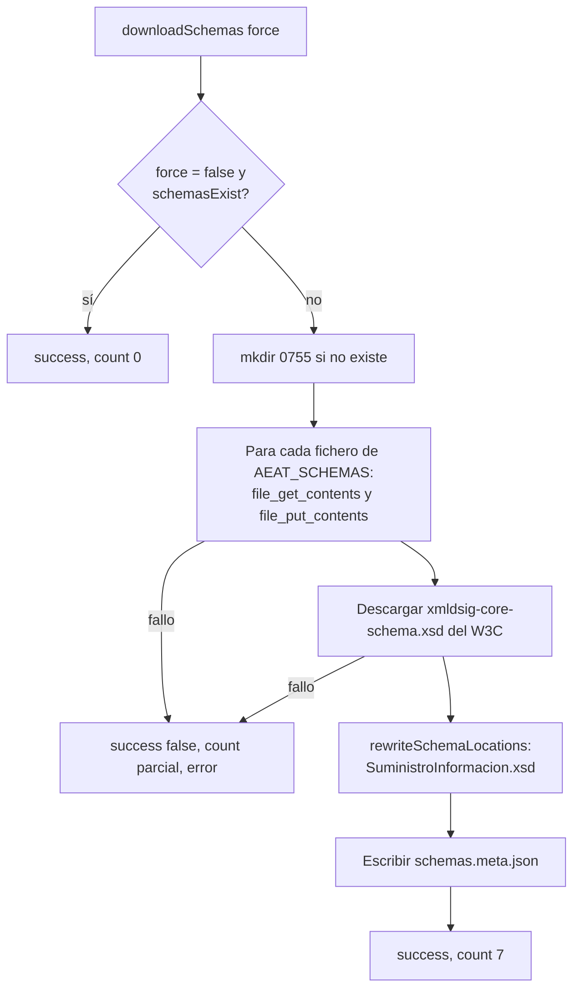

# Esquemas WSDL y XSD

Para hablar con el servicio SOAP de la AEAT, PHP necesita el WSDL `SistemaFacturacion.wsdl` y los esquemas XSD que importa, entre ellos uno del W3C. Desde la versión 1.0.4 el módulo los descarga una vez y los guarda en la carpeta de documentos de la entidad, reescribiendo la referencia externa al esquema del W3C para que todo se resuelva en local. De esto se ocupa la clase `SchemaManager` de la biblioteca interna. Esta página explica qué ficheros son, dónde y cómo se cachean, cómo se refrescan, qué comprobaciones hace el módulo contra los límites del esquema antes de enviar (desde la 2.0.0) y qué ocurre cuando falta algún esquema.

## Por qué existe la caché

Con `WSDL_CACHE_NONE`, cada `new \SoapClient($wsdl)` vuelve a descargar el WSDL y a resolver sus `import`. `SuministroInformacion.xsd` importa `xmldsig-core-schema.xsd` desde `www.w3.org`, y ese servidor limita las peticiones repetidas: al validar o enviar muchas facturas seguidas, la creación del cliente SOAP empezaba a fallar. El README lo documenta en «Error SOAP por rate-limiting de W3C» y el registro de cambios de la 1.0.4 describe la solución: «Nueva clase `SchemaManager` que descarga los 7 archivos de esquema (1 WSDL + 5 XSD de AEAT + 1 XSD de W3C) localmente y reescribe las referencias `schemaLocation` para eliminar dependencias externas».

La caché elimina también la dependencia de los servidores estáticos de la AEAT en cada envío, aunque no la del propio servicio SOAP, que sigue siendo remoto.

## Qué esquemas se usan

`SchemaManager` (`lib/newfenix/src/SchemaManager.php`) define la lista en la constante `AEAT_SCHEMAS`, el origen en `AEAT_BASE_URL` y el esquema del W3C en `XMLDSIG_REMOTE_URL`:

| Fichero | Origen | Para qué sirve |
|---|---|---|
| `SistemaFacturacion.wsdl` | `https://prewww2.aeat.es/static_files/common/internet/dep/aplicaciones/es/aeat/tikeV1.0/cont/ws/` | Definición del servicio: operaciones `RegFactuSistemaFacturacion` y `ConsultaFactuSistemaFacturacion`. Es el fichero que se pasa a `\SoapClient` |
| `SuministroInformacion.xsd` | ídem | Tipos comunes de los registros. De aquí salen los límites que aplica el módulo: `IdSistemaInformatico` (`sf:TextMax2Type`), `NombreSistemaInformatico` (`sf:TextMax30Type`), `Version` (`sf:TextMax50Type`), `RechazoPrevioType` (`S`/`X`), el `Encadenamiento` como `choice` de `RegistroFacturacionAnulacionType` |
| `SuministroLR.xsd` | ídem | Estructura de la petición de suministro (alta y anulación) |
| `ConsultaLR.xsd` | ídem | Estructura de la petición de consulta |
| `RespuestaConsultaLR.xsd` | ídem | Estructura de la respuesta a la consulta |
| `RespuestaSuministro.xsd` | ídem | Estructura de la respuesta al suministro: `EstadoEnvio` (`Correcto`, `ParcialmenteCorrecto`, `Incorrecto`), `EstadoRegistro` por línea, `TiempoEsperaEnvio` |
| `xmldsig-core-schema.xsd` | `http://www.w3.org/TR/xmldsig-core/xmldsig-core-schema.xsd` | Esquema de firma XML importado por `SuministroInformacion.xsd`; es el que provocaba el *rate-limiting* |

Los seis ficheros de la AEAT se descargan del servidor estático de **pruebas** (`prewww2.aeat.es`) con independencia del entorno configurado: el WSDL es el mismo para pruebas y producción, y la URL del servicio se fija después con `__setLocation()` (ver [[Conexión SOAP y entornos|Conexion-SOAP-y-entornos]]). `SoapClient::SCHEMA_LOCATION`, la URL de respaldo cuando no hay caché, apunta al mismo WSDL remoto.

## Dónde se guardan

El módulo construye la carpeta como `$conf->verifactu->multidir_output[$conf->entity] . '/schemas'` (en `functions.submission.php`, `functions.query.php` y `admin/setup.php`), es decir:

```text
documents/verifactu/schemas/              entidad 1
documents/<entidad>/verifactu/schemas/    otras entidades con Multiempresa
├── SistemaFacturacion.wsdl
├── SuministroInformacion.xsd             con el schemaLocation del W3C reescrito
├── SuministroLR.xsd
├── ConsultaLR.xsd
├── RespuestaConsultaLR.xsd
├── RespuestaSuministro.xsd
├── xmldsig-core-schema.xsd
└── schemas.meta.json                     {"downloaded_at": "...", "timestamp": ..., "files": 7}
```

Cada entidad tiene su propia caché. La carpeta no la crea el descriptor del módulo (solo declara `temp` y `certificates`): la crea `downloadSchemas()` con `mkdir($dir, 0755, true)` la primera vez.

### Permisos

El usuario del servidor web necesita permiso de escritura sobre la carpeta de documentos de la entidad para crear `schemas/` y sus ficheros. Si `mkdir()` falla, `downloadSchemas()` devuelve `['success' => false, 'error' => 'Cannot create directory: …']`; si falla `file_put_contents()`, `'Failed to write: …'`. En la pantalla de configuración ambos casos se muestran con el mensaje `VERIFACTU_SCHEMAS_DOWNLOAD_ERROR` («Error al descargar esquemas: %s»). Los ficheros se escriben con los permisos por defecto del proceso (no se aplica `chmod`).

## Cómo se rellena la caché

### Automáticamente, en el primer uso

`Manager::provisionTransport()` (`lib/newfenix/src/Manager.php`) se ejecuta la primera vez que un `Manager` envía o consulta algo. Si el módulo ha llamado antes a `setSchemasDir()` (lo hace siempre, justo después de construir el `VerifactuManager`), crea un `SchemaManager` sobre esa carpeta y:

1. Si `schemasExist()` devuelve `false` (falta cualquiera de los siete ficheros), llama a `downloadSchemas()`.
2. Si tras ello `schemasExist()` es `true`, fija `Config::setLocalWsdlPath()` con la ruta de `SistemaFacturacion.wsdl` local.
3. Si sigue faltando algo, no fija la ruta local y el `SoapClient` usará el WSDL remoto.

El README lo resume así: «Los esquemas se descargan automáticamente la primera vez que se envía una factura».

### Manualmente, desde la configuración

En **Configuración > Módulos > VeriFactu > Configuración**, la sección «Esquemas WSDL/XSD» (`VERIFACTU_SCHEMAS_TITLE`) muestra el estado (`VERIFACTU_SCHEMAS_DOWNLOADED` «Descargados» con la fecha de `schemas.meta.json`, o `VERIFACTU_SCHEMAS_NOT_DOWNLOADED` «No descargados») y el botón **Descargar/Actualizar esquemas** (`VERIFACTU_SCHEMAS_DOWNLOAD_BUTTON`). El botón lanza la acción `downloadschemas` de `admin/setup.php`, que ejecuta `downloadSchemas(true)`: con `force = true` vuelve a descargar todo aunque los ficheros existan. El resultado se muestra con `VERIFACTU_SCHEMAS_DOWNLOAD_SUCCESS` («Esquemas descargados correctamente (%s archivos)»).

### Qué hace `downloadSchemas()`



- Las descargas usan `file_get_contents()` con un contexto de flujo con `timeout` de 30 segundos, `user_agent` `Dolibarr-VeriFactu/1.0` y verificación TLS (`verify_peer`, `verify_peer_name`). Requiere `allow_url_fopen` activo.
- Se descargan en secuencia y **la primera que falla detiene el proceso**; los ficheros ya escritos se conservan, pero `schemasExist()` seguirá siendo `false` y el siguiente uso volverá a intentarlo.
- `rewriteSchemaLocations()` sustituye en `SuministroInformacion.xsd` la cadena `schemaLocation="http://www.w3.org/TR/xmldsig-core/xmldsig-core-schema.xsd"` por `schemaLocation="xmldsig-core-schema.xsd"`. Es la única referencia absoluta que se reescribe; los demás esquemas se referencian entre sí por nombre de fichero y se resuelven en la misma carpeta.
- `schemas.meta.json` registra `downloaded_at` (fecha legible), `timestamp` y `files` (número de ficheros). Lo lee `getDownloadMetadata()` para la pantalla de configuración.

### Métodos de `SchemaManager`

| Método | Descripción |
|---|---|
| `new SchemaManager(string $schemasDir)` | Carpeta de la caché (se elimina la barra final) |
| `getLocalWsdlPath()` | `<carpeta>/SistemaFacturacion.wsdl` |
| `schemasExist()` | `true` solo si existen los seis ficheros de la AEAT y `xmldsig-core-schema.xsd` |
| `downloadSchemas(bool $force = false)` | Descarga y reescritura; devuelve `['success' => bool, 'count' => int, 'error' => string]` |
| `getDownloadMetadata()` | Contenido de `schemas.meta.json` o `null` |
| `clearSchemas()` | Borra los siete ficheros y el meta. No hay botón que lo llame; lo usan los tests |
| `getSchemasDir()` | Carpeta configurada |

## Cómo se usa la caché al conectar

`SoapClient::resolveWsdlLocation()` devuelve la ruta local si `Config::getLocalWsdlPath()` no es `null` y el fichero existe; en caso contrario, la URL remota `SCHEMA_LOCATION`. `assembleTransportOptions()` elige `WSDL_CACHE_DISK` cuando hay WSDL local y `WSDL_CACHE_NONE` cuando no. Después fusiona las opciones de certificado que recibe del módulo (`array_merge($base, $certSettings)`), y como `getCertificateOptions()` incluye `'cache_wsdl' => WSDL_CACHE_NONE`, en las llamadas hechas desde el módulo el valor efectivo es siempre `WSDL_CACHE_NONE`: PHP vuelve a analizar el WSDL en cada petición, pero lo lee del disco local, que es lo que evita el *rate-limiting*.

## Validación del registro contra los límites del esquema

Desde la 2.0.0 (PR #40, «Validación del registro antes de enviarlo»), el registro se comprueba localmente contra los límites tomados de `SuministroInformacion.xsd` antes de llamar al servicio. No es una validación XML con `DOMDocument::schemaValidate()`: son comprobaciones programadas en `Invoice::validate()` y `Cancellation::validate()`, que `getData()` ejecuta siempre antes de devolver el registro, es decir, dentro de `Manager::sendInvoice()` y `Manager::sendCancellation()`.

| Comprobación (`Invoice::validate()`) | Límite |
|---|---|
| Campos obligatorios del registro y de `IDFactura` | Presentes y no vacíos |
| `TipoFactura` | F1, F2, F3, R1, R2, R3, R4 o R5 |
| `NombreRazonEmisor` | ≤ 120 caracteres (`mb_strlen`) |
| `DescripcionOperacion` | ≤ 500 caracteres |
| Destinatarios | Ninguno en F2 y R5; al menos uno en el resto; nunca más de 1000 |
| Líneas de desglose | Entre 1 y 12 |
| Encadenamiento | `PrimerRegistro` o `RegistroAnterior` |
| Huella anterior y propia | 64 caracteres hexadecimales en mayúsculas (`/^[0-9A-F]{64}$/`) |

`Cancellation::validate()` exige los campos obligatorios y un encadenamiento. Además, `getDeclaredSystemIdentity()` (`lib/functions/functions.configuration.php`) aplica los límites de 30/2/50 caracteres al bloque `SistemaInformatico` y registra en el log cualquier recorte; ver [[Declaración responsable|Declaracion-responsable]].

Cuando una comprobación falla, la biblioteca lanza `\InvalidArgumentException` con un mensaje en inglés («Operation description cannot exceed 500 characters», «Must have at least one recipient»…). `execVERIFACTUCall()` la captura, guarda `Exception: <mensaje>` en `verifactu_error`, pone el estado en «Error» y devuelve `false`; si el envío formaba parte de una validación, el trigger revierte la factura a borrador. Los casos están cubiertos por `tests/InvoiceValidationTest.php` (ver [[Suite de pruebas|Suite-de-pruebas]]).

Por encima de estas comprobaciones, el propio `\SoapClient` de PHP codifica la petición según los tipos del WSDL, y la AEAT valida el mensaje completo en el servidor y responde con su código de error (ver [[Códigos de error|Codigos-de-error]] y [[Respuestas de la AEAT|Respuestas-de-la-AEAT]]).

## Qué ocurre si falta un esquema

| Situación | Comportamiento |
|---|---|
| Falta cualquiera de los siete ficheros | `schemasExist()` es `false`; `provisionTransport()` intenta la descarga completa antes de cada nueva instancia de `Manager` |
| La descarga falla (sin salida a Internet, `allow_url_fopen` desactivado, carpeta sin permisos) | No se fija el WSDL local; `SoapClient` usa el WSDL remoto de `prewww2.aeat.es` con `WSDL_CACHE_NONE`. El envío puede funcionar, pero vuelve a depender de la AEAT y del W3C en cada petición |
| El WSDL remoto tampoco se puede leer | `new \SoapClient()` lanza `\SoapFault` con un mensaje del tipo `SOAP-ERROR: Parsing WSDL: Couldn't load from '…'`. Como la construcción del cliente ocurre en `buildTransport()`, fuera del `try` de `executeOperation()`, esa excepción llega al módulo como `\SoapFault`, no como `BillingException`; `execVERIFACTUCall()` la trata como cualquier otra excepción |
| Un fichero está corrupto o incompleto | PHP falla al analizar el WSDL con el mismo tipo de error. Solución: **Descargar/Actualizar esquemas** para sobrescribirlos |
| Se borra la carpeta `schemas/` | Se recrea y rellena en el siguiente envío o consulta |

En la pantalla de configuración, un estado «No descargados» después de haber enviado facturas indica que la descarga automática no ha podido completarse y que los envíos se están haciendo contra el WSDL remoto.

## Cómo actualizar los esquemas

Si la AEAT publica una versión nueva de los esquemas **en la misma ruta**, basta con pulsar **Descargar/Actualizar esquemas**: `downloadSchemas(true)` sobrescribe los siete ficheros y `schemas.meta.json`. Como alternativa, borrar los ficheros de `schemas/` produce el mismo efecto en el siguiente envío.

Si la AEAT publica los esquemas en **otra ruta o versión** (la actual incluye `tikeV1.0` en la URL), la caché seguiría descargando los antiguos: en ese caso hay que actualizar las constantes `AEAT_BASE_URL` y `AEAT_SCHEMAS` de `SchemaManager` y `SCHEMA_LOCATION` de `SoapClient`, lo que corresponde a una nueva versión del módulo. Cualquier cambio en los límites del esquema exige también revisar `Invoice::validate()` y los límites de `getDeclaredSystemIdentity()`.

> **Aviso:** los esquemas cacheados se descargan del servidor de pruebas de la AEAT. Si la AEAT llegara a publicar esquemas distintos para producción, la caché no lo reflejaría; en la versión actual el WSDL es único y solo cambia la dirección del servicio.

## Pruebas relacionadas

- `tests/SchemaManagerTest.php`: sin acceso a red, comprueba `schemasExist()` con carpeta vacía, completa y con un fichero de menos; la ruta del WSDL; la reescritura del `schemaLocation` del W3C; que `downloadSchemas(false)` no descarga nada cuando ya existen; `getDownloadMetadata()` con y sin meta; `clearSchemas()`; el recorte de la barra final; y la integración con `Config::setLocalWsdlPath()` y `reset()`.
- `tests/InvoiceValidationTest.php`: los límites del esquema aplicados por `Invoice::validate()`.
- `tests/PriorRejectionTest.php`: la semántica `S`/`X` de `RechazoPrevio` definida en `SuministroInformacion.xsd`.

## Véase también

- [[Conexión SOAP y entornos|Conexion-SOAP-y-entornos]] — cómo se construye el cliente SOAP y qué opciones se aplican.
- [[Biblioteca newfenix|Biblioteca-newfenix]] — `SchemaManager`, `Config`, `Invoice::validate()`.
- [[Configuración|Configuracion]] — la sección de esquemas de la pantalla de ajustes.
- [[Requisitos|Requisitos]] — `allow_url_fopen`, salida HTTPS y permisos de la carpeta de documentos.
- [[Resolución de problemas|Resolucion-de-problemas]] — errores al crear el cliente SOAP.
- [[Multiempresa|Multiempresa]] — una caché por entidad.
- [[Suite de pruebas|Suite-de-pruebas]] — cómo ejecutar `SchemaManagerTest.php`.
