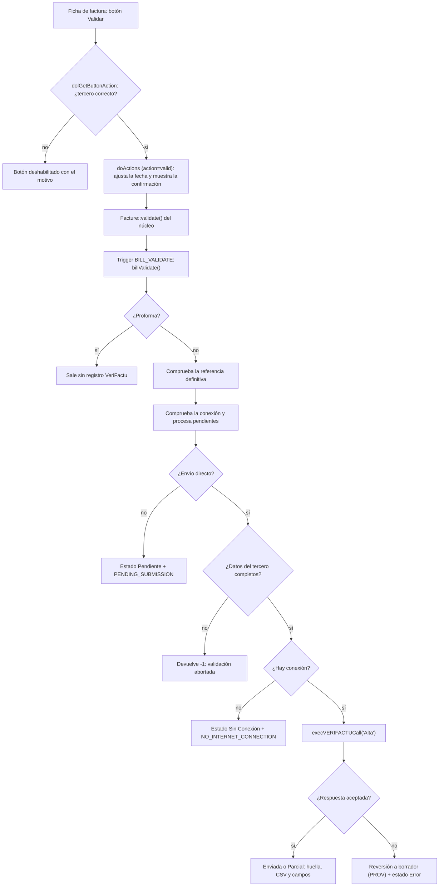

# Flujo de validación y envío

Esta página recorre, paso a paso, lo que ocurre desde que se pulsa **Validar** en una factura de cliente hasta que el registro de facturación queda enviado a la AEAT (o marcado como pendiente, o la factura devuelta a borrador). El módulo se engancha en tres puntos del núcleo de Dolibarr: los *hooks* de la ficha de factura (`class/actions_verifactu.class.php`), el trigger de negocio `BILL_VALIDATE` (`core/triggers/interface_999_modVerifactu_VerifactuTriggers.class.php`) y la función orquestadora `execVERIFACTUCall()` (`lib/functions/functions.submission.php`). El comportamiento descrito corresponde a la versión 2.2.2.

## Visión general



## Piezas que intervienen

| Fichero | Función o método | Papel en el flujo |
|---|---|---|
| `class/actions_verifactu.class.php` | `dolGetButtonAction()` | Deshabilita **Validar**, **Modificar** y **Eliminar** cuando procede |
| `class/actions_verifactu.class.php` | `doActions()` (contexto `invoicecard`) | Ajusta la fecha, calcula la referencia definitiva y sustituye el texto de confirmación |
| `core/triggers/interface_999_modVerifactu_VerifactuTriggers.class.php` | `billCreate()` | Inicializa los campos adicionales `verifactu_*` al crear la factura |
| `core/triggers/interface_999_modVerifactu_VerifactuTriggers.class.php` | `billValidate()` | Decide si se envía, envía y revierte a borrador si falla |
| `lib/functions/functions.submission.php` | `execVERIFACTUCall()` | Orquesta certificado, configuración, bloqueo de la cadena y despacho de la acción |
| `lib/functions/functions.submission.php` | `handleInvoiceCreationOrSubsanation()` | Construye el registro de alta (o subsanación) y lo envía |
| `lib/functions/functions.submission.php` | `processInvoiceSendResponse()` | Traduce la respuesta de la AEAT a estado y campos adicionales |
| `lib/functions/functions.hash.php` | `getLastInvoiceHash()`, `acquireVerifactuChainLock()` | Encadenamiento y sección crítica |
| `lib/functions/functions.query.php` | `preCheckInvoiceInAEAT()`, `manejarFacturaDuplicada()` | Consulta previa y tratamiento del error 3000 |
| `lib/functions/functions.response.php` | `saveVerifactuSuccessData()`, `saveVerifactuErrorData()` | Persistencia con conexión independiente |
| `class/verifactu.utils.php` | `VerifactuUtils::sendInvoicesWithErrors()` | Cola de reintentos, ejecutada también antes de validar |
| `lib/newfenix/src/Invoice.php`, `Manager.php`, `SoapClient.php` | `VerifactuInvoice`, `VerifactuManager` | Modelo del registro, huella y transporte SOAP |

## Antes de validar: la ficha de la factura

### El botón «Validar»

El hook `dolGetButtonAction()` intercepta los botones de la ficha (`contexto invoicecard`). Para una factura en borrador (referencia con `PROV`), cuando la URL del botón contiene `action=valid`, comprueba el tercero:

| Comprobación | Condición que produce el error | Clave del mensaje |
|---|---|---|
| CIF/NIF | País `ES` y `idprof1` vacío | `VERIFACTU_INVOICE_CAN_NOT_BE_VALID_CIF_REQUIRED` |
| CIF intracomunitario | País distinto de `ES` y `tva_intra` vacío | `VERIFACTU_INVOICE_CAN_NOT_BE_VALID_TVA_INTRA_REQUIRED` |
| Dirección | `address` vacío | `VERIFACTU_INVOICE_CAN_NOT_BE_VALID_ADDRESS_REQUIRED` |

Ninguna de las tres se aplica si la factura viene de TakePOS (`module_source == 'takepos'`) o si el tercero tiene marcado el campo adicional `verifactu_factura_simplificada = 1`. Si hay errores, el botón se sustituye por un `<span class="butActionRefused">` cuyo *tooltip* concatena todos los motivos, y la URL pasa a `action=view`. Las mismas tres comprobaciones se repiten dentro del trigger, por lo que tampoco se pueden sortear validando desde otra vía.

> **Nota:** el texto de estos avisos es, por ejemplo, «Factura %s: CIF/NIF del cliente obligatorio para VeriFactu». El código pide las claves con la grafía `CAN_NOT` y los ficheros de idioma las definían como `CANNOT`; hasta la 2.2.1 el aviso aparecía como clave sin traducir. Desde la 2.2.2 ambas grafías están definidas en los cinco idiomas.

### Fecha forzada, referencia definitiva y texto de confirmación

Cuando la ficha recibe `action=valid` (el paso en el que Dolibarr muestra el diálogo de confirmación) y la referencia contiene `PROV`, `doActions()` hace tres cosas:

1. Pone en memoria `$conf->global->FAC_FORCE_DATE_VALIDATION = true` (para el resto de peticiones de la ficha lo deja a `false`, sea cual sea el valor guardado en la base de datos).
2. Calcula la fecha mínima admisible: `max(hoy, fecha de la última factura encadenada)`. La última factura la obtiene de `getLastInvoiceHash()`. Si la fecha de la factura difiere de ese mínimo, la sustituye (`$object->date`) y la **escribe ya en la base de datos** con `setValueFrom('datef', …)`. El ajuste queda hecho al abrir el diálogo, no al confirmarlo.
3. Obtiene la referencia que recibirá la factura con `getNextNumRef($object->thirdparty)` y sustituye la traducción estándar `ConfirmValidateBill` por `ConfirmValidateBillVerifactu`, cuyo texto en español es:

> ¿Validar factura **%s**?
> ⚠️ **IMPORTANTE:** Se enviarán los datos a VeriFactu de la AEAT. **No podrá editar ni eliminar** esta factura después.
> 📋 **VERIFIQUE antes de continuar:** Impuesto, Clave Régimen, Calificación y Exención.
> ⚖️ **Usted es responsable** de la veracidad de estos datos fiscales. En caso de duda, **consulte con su asesor fiscal**.

Si la fecha se ajustó, al texto se añade `VERIFACTU_SINGLE_VALIDATE_DATE_ADJUSTED`: «⚠️ **Ajuste de fecha:** La fecha original de la factura (**%s**) se ha ajustado a **%s** para respetar el orden cronológico de VeriFactu (última factura validada: %s)». El detalle de la regla cronológica está en [[Fechas y numeración|Fechas-y-numeracion]].

## Al crear la factura: `BILL_CREATE`

El método `billCreate()` del trigger 999 prepara los campos adicionales para que el registro pueda construirse después. Vacía primero todos los `array_options` (para que una factura clonada no herede huella ni estado) y asigna:

| Campo adicional | Valor inicial | Observaciones |
|---|---|---|
| `verifactu_estado` | Badge «No Enviada» (`badge-status8`) | Texto `VERIFACTU_STATUS_NOT_SEND` |
| `verifactu_impuesto` | Lo enviado en el formulario o `TAX_VAT` (`01`) | |
| `verifactu_clave_regimen` | Lo enviado o `REGIME_GENERAL` (`01`) | |
| `verifactu_calificacion_operacion` | Lo enviado o `QUAL_TAXABLE` (`S1`) | |
| `verifactu_operacion_exenta` | Lo enviado o `0` | |
| `verifactu_factura_tipo` | Según el tipo de Dolibarr y el origen | Véase la tabla siguiente |

| Origen / tipo Dolibarr | Tipo VeriFactu |
|---|---|
| TakePOS, `Facturesim` o tercero con `verifactu_factura_simplificada = 1` | `F2` (`R5` si es abono) |
| `TYPE_STANDARD`, `TYPE_SITUATION`, `TYPE_DEPOSIT` | `F1` |
| `TYPE_REPLACEMENT`, `TYPE_CREDIT_NOTE` | `R1` (unificado en 2.0.0 con lo que realmente se transmite) |
| `TYPE_PROFORMA` | Vacío: la proforma queda fuera de VeriFactu |

Después aplica, por orden de especificidad, los valores globales `VERIFACTU_DEFAULT_TAX_TYPE`, `VERIFACTU_DEFAULT_TAX_REGIME`, `VERIFACTU_DEFAULT_OPERATION_QUALIFICATION` y `VERIFACTU_DEFAULT_EXEMPT_OPERATION`, y por último los del tercero (`verifactu_impuesto`, `verifactu_clave_regimen`, `verifactu_calificacion_operacion`, `verifactu_operacion_exenta` de la ficha del tercero), que tienen la máxima prioridad y generan un aviso cuando se aplican. Los detalles de cada campo están en [[Campos adicionales|Campos-adicionales]] y [[Tipos de factura|Tipos-de-factura]].

El trigger no define métodos para `BILL_MODIFY` ni `BILL_PAYED`: esos eventos no tienen efecto en el módulo. Las restricciones sobre modificación, borrado y desvalidación viven en el trigger 900 (véase [[Restricciones sobre facturas enviadas|Restricciones-sobre-facturas-enviadas]]).

## El trigger `BILL_VALIDATE` paso a paso

`Facture::validate()` del núcleo escribe la referencia definitiva y el estado, y a continuación llama a `BILL_VALIDATE` **dentro de su propia transacción**. Si el trigger devuelve un valor negativo, el núcleo revierte la validación. `billValidate()` ejecuta, en este orden:

1. **Exclusión de proformas.** `isVerifactuApplicableInvoice($object)` (`lib/functions/functions.compatibility.php`) devuelve `false` para `TYPE_PROFORMA`; el trigger devuelve `0` y la proforma se valida en Dolibarr sin generar registro de facturación (Art. 6 RD 1007/2023, incorporado en 2.0.0).
2. **Comprobación de la referencia definitiva.** Si la referencia actual es provisional (`substr($object->ref, 1, 4) == 'PROV'`), obtiene la definitiva con `getNextNumRef()` y la valida: sin espacios (`VERIFACTU_INVOICE_REF_CONTAINS_SPACES`), solo `[a-zA-Z0-9\-_\/]` (`VERIFACTU_INVOICE_REF_NOT_ALPHANUMERIC`) y máximo 60 caracteres (`VERIFACTU_INVOICE_REF_TOO_LONG`). Cualquier fallo devuelve `-1` y la validación se aborta antes de tocar nada.
3. **Comprobación de conexión.** `checkInternetConnection()` se ejecuta una sola vez (véase [[Reintentos y envíos pendientes|Reintentos-y-envios-pendientes]] para los métodos que usa).
4. **Cola de pendientes.** Si hay conexión, se instancia `VerifactuUtils` y se llama a `sendInvoicesWithErrors()` para enviar antes las facturas que quedaron pendientes; así la nueva factura se encadena detrás de ellas. Si se procesó alguna, se muestra el mensaje `"%d pending invoices processed automatically"` (texto fijo en inglés en el código).
5. **Decisión de envío directo.** `$conditionToDirectCall = module_source == 'takepos' || VERIFACTU_DIRECT_CALL_ON_VALIDATE`. Las facturas de TakePOS se envían siempre en la validación.
6. **Datos del tercero** (solo con envío directo): las tres comprobaciones de la tabla anterior. Si falla alguna, se muestran todos los errores y el trigger devuelve `-1`.
7. **Sin conexión:** estado «Sin Conexión» (`badge-status1`), `verifactu_error = 'NO_INTERNET_CONNECTION'`, `verifactu_incidencia = 'S'`; se guardan con `updateExtraField()`, se avisa con `VERIFACTU_HAS_NO_INTERNET_CONNECTION` («Sin conexión a internet. La factura %s se validará localmente. Realice el envío manual posteriormente.») y el trigger devuelve `1`: la factura queda validada y pendiente.
8. **Envío:** `execVERIFACTUCall($object, 'Alta', false)`. El tercer parámetro indica que **no** se respeta el tiempo de espera que pueda haber pedido la AEAT: abortar aquí devolvería la factura a borrador, y una ventana de espera no debe deshacer una factura emitida.
9. **Éxito:** mensaje `VERIFACTU_SUCCESS` («Operación completada correctamente») y `return 1`.
10. **Fallo:** el módulo no confía en el *rollback* del núcleo (las transacciones anidadas no revierten correctamente en Dolibarr) y revierte la factura por su cuenta con una **conexión de base de datos independiente** (`getDoliDBInstance()`):

```sql
UPDATE llx_facture
   SET fk_statut = 0,
       ref = '(PROV{id})',
       date_valid = NULL,
       fk_user_valid = NULL
 WHERE rowid = {id};
```

   También actualiza el objeto en memoria (`ref`, `status`, `statut`, `date_valid`), muestra `VERIFACTU_ERROR_INVOICE_NOT_VALIDATED` («El envío a VeriFactu falló para la factura %s. La factura permanece como borrador - corrija los problemas e inténtelo de nuevo.») y devuelve `-1`. Los datos del error ya se han guardado dentro de `execVERIFACTUCall()`, también por conexión independiente, de modo que sobreviven al *rollback*.

11. **Envío directo desactivado** (y la factura no viene de TakePOS): se llega al final del método y la factura se deja marcada como pendiente; véase la sección siguiente.

## Envío directo desactivado: `PENDING_SUBMISSION`

Desde la 2.1.0, desactivar `VERIFACTU_DIRECT_CALL_ON_VALIDATE` («Envío automático al validar») decide **cómo** llega el registro a la AEAT, no **si** existe. El trigger deja la factura así:

| Campo | Valor |
|---|---|
| `verifactu_estado` | Badge «Pendiente» (`VERIFACTU_STATUS_PENDING_SERVICE`, `badge-status1`) |
| `verifactu_error` | `PENDING_SUBMISSION` |
| `verifactu_incidencia` | `S` |
| `verifactu_ultimafecha_modificacion` | `dol_now()` |

Se avisa con `VERIFACTU_PENDING_SUBMISSION_INFO` («La factura %s se ha validado con el registro VeriFactu pendiente de envío, porque el envío directo en la validación está desactivado. Se enviará desde la cola de reintentos.») y la cola de reintentos (`VerifactuUtils`) la recoge igual que a las facturas sin conexión. En este camino no se aplican las comprobaciones de tercero del paso 6; se aplicarán cuando el envío real las necesite (un destinatario sin identificación hace fallar la validación del registro).

## Dentro de `execVERIFACTUCall()`

`execVERIFACTUCall(Facture $facture, $actionVERIFACTU = 'Alta', $enforceWaitTime = true)` es el único punto de entrada al servicio para altas, subsanaciones (`Mod`) y anulaciones (`Baja`). Secuencia:

1. **Tiempo de espera de la AEAT.** `getAEATWaitTimeRemaining()` lee `VERIFACTU_NEXT_SEND_AT`. Si queda espera y `$enforceWaitTime` es `true`, aborta con `VERIFACTU_AEAT_WAIT_REQUIRED`; si es `false` (validación, pestaña VeriFactu, envío masivo) solo lo anota en el registro.
2. **Recarga** la factura (`fetch`) y vuelve a comprobar que no es proforma; comprueba que la acción es `Alta`, `Mod` o `Baja` (`INVALID_VERIFACTU_ACTION`).
3. **Consulta previa** (solo `Alta`): `preCheckInvoiceInAEAT()` consulta a la AEAT por número y fecha. Si la factura ya existe con los mismos importes, se marca como enviada sin reenviar (`VERIFACTU_PRECHECK_ALREADY_EXISTS` en «Última respuesta», aviso `VERIFACTU_PRECHECK_SKIP_SEND`) y devuelve `true`. Si existe con importes distintos, avisa con `VERIFACTU_PRECHECK_AMOUNTS_DIFFER` y devuelve `false`. Esta consulta evita el error 3000 (duplicado).
4. **Configuración y certificado:** `getEnvironment()`, `VERIFACTU_HOLDER_NIF`, `VERIFACTU_HOLDER_COMPANY_NAME`, `getCertificateOptions()` y `validateCertificateAndKey()`. Un NIF o nombre vacíos producen `VERIFACTU_CONFIG_INCOMPLETE`; un certificado inválido, un mensaje `Certificate error: …`. En todos estos casos la función devuelve `false` sin lanzar excepción, por lo que **no** se escribe estado de error en la factura, pero la validación se revierte igualmente. Véanse [[Configuración|Configuracion]] y [[Certificados digitales|Certificados-digitales]].
5. **Sistema informático:** `getSystemConfig()` aporta el bloque `SistemaInformatico` (identidad tomada de la declaración responsable; véase [[Declaración responsable|Declaracion-responsable]]).
6. **`VerifactuManager`** se instancia con NIF, nombre, entorno, servicio `verifactu`, configuración del sistema y `VERIFACTU_CERT_TYPE` (`normal` por defecto). Los esquemas WSDL/XSD se toman de la subcarpeta `schemas` de la carpeta de documentos del módulo para la entidad (`$conf->verifactu->multidir_output[$conf->entity]`, por ejemplo `documents/verifactu/schemas`); si no existen se descargan (véase [[Esquemas WSDL y XSD|Esquemas-WSDL-y-XSD]]).
7. **Bloqueo de la cadena:** `acquireVerifactuChainLock()`. Si no se obtiene en el tiempo configurado, se lanza la excepción `VERIFACTU_CHAIN_LOCK_BUSY`. El bloqueo se libera en un bloque `finally`, también cuando el envío lanza una excepción. Detalles en [[Encadenamiento y huella|Encadenamiento-y-huella]].
8. **Despacho:** `Alta` → `handleInvoiceCreationOrSubsanation()`; `Mod` → la misma función con `$isSubsanacion = true`; `Baja` → `handleInvoiceCancellation()` con el tipo `tipo_anulacion` recibido por POST (`normal` por defecto).
9. **Excepciones:** cualquier excepción (validación del registro contra el esquema, fallo SOAP distinto de 503, cadena ilegible, bloqueo ocupado…) se captura: el manejador vuelve a leer los campos guardados de la factura y `buildVerifactuExceptionErrorData()` decide qué escribir con `saveVerifactuErrorData()`: siempre `verifactu_error = 'Exception: …'`, `verifactu_ultima_salida = 'VeriFactu Exception: …'` y la fecha de modificación; el estado «Error» (`badge-status8`) solo si la factura no tiene huella, es decir, si la AEAT nunca aceptó un registro suyo. La huella y el CSV **no se tocan nunca** (hasta la 2.2.1 se vaciaban, lo que en una baja o subsanación fallida borraba el registro de un alta aceptada). Se avisa con `VERIFACTU_EXCEPTION` («Error VeriFactu: %s») y se devuelve `false`.

## Construcción del registro de alta

`handleInvoiceCreationOrSubsanation()` monta el objeto `VerifactuInvoice` (clase `Invoice` de la biblioteca `newfenix`, expuesta con ese alias):

1. `new VerifactuInvoice($facture->ref, date('d-m-Y', $facture->date), $issuerNif, $issuerName)`; para `Mod`, `VerifactuInvoice::createSubsanacion(...)`, que añade `Subsanacion = 'S'` (véase [[Respuestas de la AEAT|Respuestas-de-la-AEAT]] para `RechazoPrevio`).
2. `setSystemInfo()`, descripción `Invoice {ref}` más `Customer Ref: {ref_client}` si existe, `setType()` con `verifactu_factura_tipo` (por defecto `F1`), `setIncidence()` con `verifactu_incidencia` (por defecto `N`) y `setExternalReference($facture->id)`.
3. **Rectificativas:** un abono (`TYPE_CREDIT_NOTE`) se envía como `R1` con rectificación por diferencias (`I`), o `R5` si viene de TakePOS; una factura de sustitución (`TYPE_REPLACEMENT`) se envía como `R1` por sustitución (`S`) e incluye el bloque `FacturasRectificadas` con la base, cuota y recargo de la factura origen (`fk_facture_source`). Véase [[Facturas rectificativas|Facturas-rectificativas]].
4. **Destinatario:** se omite para `F2` y `R5`. Para España (o país vacío) se usa `idprof1`; para el resto, `tva_intra` con el tipo de identificación `verifactu_tipo_identificacion` del tercero (`02`, NIF-IVA, por defecto).
5. **Líneas:** `getVerifactuParams()` lee impuesto, clave de régimen, calificación y exención de la factura. Si falta el tipo de impuesto, o la clave de régimen no cumple la regla (obligatoria para IVA e IGIC, prohibida para IPSI y Otros), se lanza una excepción con texto en inglés («ERROR: Tax Type not configured…»). Por cada línea se llama a `addDesglose()`; las líneas con recargo de equivalencia fuerzan la clave `18`; las operaciones `N1`/`N2` se envían solo con base; los abonos se envían en positivo. Véase [[Desglose de impuestos|Desglose-de-impuestos]].
6. **Encadenamiento:** `getLastInvoiceHash()` → `setChainLink()` con NIF, número, fecha y huella del registro anterior, o `setAsFirstInChain()` si la cadena está vacía.
7. **Envío:** `$manager->sendInvoice($invoice, $certOptions)`. Si el transporte lanza una excepción con código 503 o cuyo mensaje contiene `service unavailable`/`Service Unavailable`/`HTTP 503`, la factura se marca «Pendiente» con `verifactu_error = 'SERVICE_UNAVAILABLE'` e `incidencia = 'S'`, se avisa con `VERIFACTU_SERVICE_UNAVAILABLE_INFO` y la función devuelve **`true`**: la validación se completa y el envío queda para la cola de reintentos. Cualquier otra excepción se relanza.
8. **Respuesta:** `registerAEATWaitTime($response)` anota el `TiempoEsperaEnvio` y `processInvoiceSendResponse()` la interpreta.

Antes de transmitir, `Invoice::getData()` ejecuta `validate()` (límites del esquema: tipo permitido, `NombreRazonEmisor` ≤ 120, `DescripcionOperacion` ≤ 500, entre 1 y 1000 destinatarios salvo simplificadas, entre 1 y 12 detalles de desglose, encadenamiento presente y huellas de 64 hexadecimales en mayúsculas) y genera la huella si no existe. Un registro inválido se rechaza localmente con `InvalidArgumentException`, que sigue el camino de excepción descrito arriba.

## Procesado de la respuesta (resumen)

`processInvoiceSendResponse()` aplica `isAEATResponseAccepted()`: la respuesta se acepta si `EstadoEnvio` es `Correcto`, o si es `ParcialmenteCorrecto` y **todas** las líneas tienen `EstadoRegistro` `Correcto` o `AceptadoConErrores`.

| Resultado | Estado (`verifactu_estado`) | Devuelve | Campos que se rellenan |
|---|---|---|---|
| Aceptada, `Correcto` | «Enviada» (`badge-status4`) | `true` | CSV, payload, entorno, modo, última respuesta, fecha modificación, `IDFactura`, fecha de factura, huella, fecha/hora de generación; `verifactu_error` se vacía |
| Aceptada, `ParcialmenteCorrecto` | «Parcial» (`badge-status1`) | `true` | Los mismos |
| Rechazada con error 3000 e importes iguales | «Enviada (Duplicada)» | `true` | Huella tomada de la AEAT si la devuelve |
| Rechazada con error 3000 e importes distintos | «Duplicada (Importes diferentes)» | `false` | `verifactu_error` con el detalle |
| Rechazada (otros códigos) | «Error» (`badge-status8`) | `false` | `verifactu_error`, última respuesta |
| Sin respuesta | «Error» | `false` | `verifactu_error = 'No response received from VeriFactu server'` |

El detalle de cada caso, los campos de la respuesta y las respuestas parciales están en [[Respuestas de la AEAT|Respuestas-de-la-AEAT]]; los códigos de error, en [[Códigos de error|Codigos-de-error]].

## Estados resultantes

Los estados se guardan como HTML de *badge* en `verifactu_estado` y se muestran en la ficha, el listado y la pestaña VeriFactu.

| Texto | Clase CSS | Cuándo |
|---|---|---|
| No Enviada | `badge-status8` | Al crear la factura y al activar el módulo (facturas sin estado) |
| Enviada | `badge-status4` | Respuesta `Correcto`, o consulta previa/verificación con importes coincidentes |
| Parcial | `badge-status1` | `ParcialmenteCorrecto` con todas las líneas aceptadas |
| Error | `badge-status8` | Rechazo de la AEAT, excepción o ausencia de respuesta |
| Sin Conexión | `badge-status1` | Sin conexión en el momento de validar |
| Pendiente | `badge-status1` | Servicio no disponible (503) o envío directo desactivado |
| Enviada (Duplicada) | `badge-status4` | Error 3000 con importes coincidentes |
| Duplicada (Importes diferentes) | `badge-status1` | Error 3000 con importes distintos: requiere decisión |
| Anulada | `badge-status6` | Anulación aceptada (`lib/functions/functions.cancellation.php`) |

## Transacciones y conexiones independientes

- La validación del núcleo es una transacción; el trigger se ejecuta dentro de ella y un retorno negativo provoca el *rollback* del núcleo.
- Todo lo que el módulo necesita conservar aunque la validación se revierta (estado, error, última respuesta, CSV, huella, reversión a borrador) se escribe con una **segunda conexión** creada con `getDoliDBInstance()` (`saveVerifactuSuccessData()`, `saveVerifactuErrorData()` y el bloque de reversión del trigger). En PostgreSQL esa conexión no se cierra explícitamente, porque puede coincidir con la principal.
- Si la conexión independiente no puede crearse, las funciones recurren a `insertExtraFields()` sobre la conexión principal, cuyo resultado sí puede perderse con el *rollback*.
- En la validación masiva el módulo abre además una transacción por factura (véase [[Validación masiva|Validacion-masiva]]).

> **Importante:** el registro de facturación se firma y se encadena en el momento del envío. Una vez que la factura tiene huella y CSV, no debe modificarse ni desvalidarse; el módulo lo impide (véase [[Restricciones sobre facturas enviadas|Restricciones-sobre-facturas-enviadas]]) y la vía correcta es una rectificativa o una anulación.

## Otras vías de envío

Además de la validación, `execVERIFACTUCall()` se invoca desde:

- La pestaña **VeriFactu** de la factura (`views/tabVERIFACTU.facture.php`): botones «Enviar Alta», «Enviar Modificación» y «Enviar Baja», siempre con `$enforceWaitTime = false`. Véase [[Pestaña VeriFactu de la factura|Pestana-VeriFactu-de-la-factura]].
- El listado **Facturas emitidas** del módulo (`views/list.facture.php`): mismos tres botones sobre las facturas seleccionadas; se omiten en silencio las ya enviadas, las provisionales (`VERIFACTU_VALIDATION_INVOICE_PROVISIONAL`) y las que no están validadas o cerradas (`INVALID_VERIFACTU_STATUS_TO_SEND`).
- La cola de reintentos (`VerifactuUtils`), la única vía que respeta el tiempo de espera de la AEAT. Véase [[Reintentos y envíos pendientes|Reintentos-y-envios-pendientes]].
- TakePOS, cuyas facturas pasan por el mismo trigger con envío directo forzado. Véase [[TakePOS|TakePOS]].

## Véase también

- [[Encadenamiento y huella|Encadenamiento-y-huella]]
- [[Validación masiva|Validacion-masiva]]
- [[Fechas y numeración|Fechas-y-numeracion]]
- [[Reintentos y envíos pendientes|Reintentos-y-envios-pendientes]]
- [[Respuestas de la AEAT|Respuestas-de-la-AEAT]]
- [[Restricciones sobre facturas enviadas|Restricciones-sobre-facturas-enviadas]]
- [[Tipos de factura|Tipos-de-factura]]
- [[Campos adicionales|Campos-adicionales]]
- [[Conexión SOAP y entornos|Conexion-SOAP-y-entornos]]
- [[Registro y depuración|Registro-y-depuracion]]
